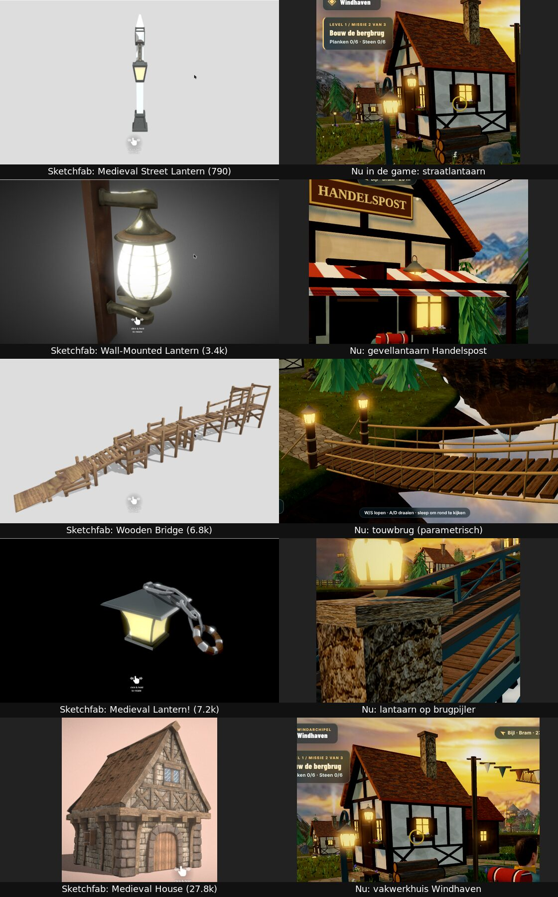
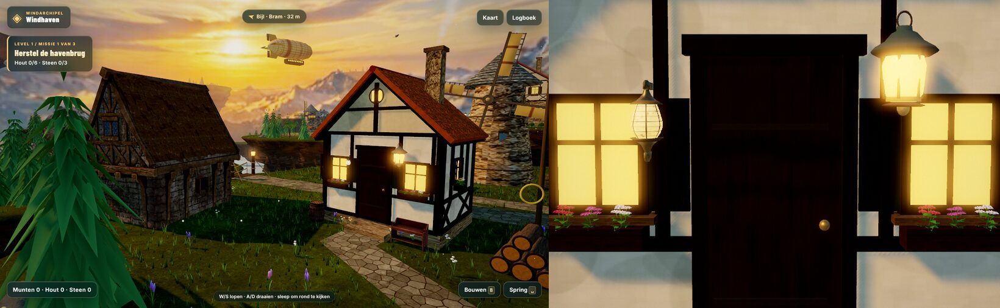

# Asset-onderzoek batch 1: Sketchfab-kandidaten

**Datum:** 22 november 2026
**Branch:** `assets-extern` (afgesplitst van `visuals-1.7`, versie 1.14.1)
**Status:** beoordeeld, niets gedownload, niets ingebouwd

## Projectstatus vooraf (instructie §2)

| Onderwerp | Stand |
|---|---|
| Productie (`main`) | 1.13.0 |
| `visuals-1.7` | 1.14.1, niet live: gescande rotsen, bergrots, kliffen, stronken, rugzakfit, nevel |
| Ingebouwd van Poly Haven | moon_rock_02, moon_rock_04, rock_07, rock_09, tree_stump_01, cliff_side, aerial_rocks_02 (zie `src/art/credits.txt`) |
| Poly Haven batch 2 (00_Inbox) | Gedownload en geconverteerd, nog niet ingebouwd. Barrel_01/02/03 zijn blauwe olievaten, WoodenTable_02 is een kruk en WoodenTable_03 een ladekast. Die gaan er dus niet in als ton of tafel. |
| Poly Haven batch 3 (meubels, tuin, ruïne, dakpannen) | **Niet gedownload.** Wacht op akkoord voor `skybound-assets-3.zip` (39,7 MB). |
| Conversie | `convert.js`: glTF → compact `.mdl` met meshoptimizer-reductie, texturen 256–1024 px, lader `src/models.js`. Staat nog buiten de repo, wordt bij de eerste integratie toegevoegd onder `tools/`. |
| Licentieregistratie | `src/art/credits.txt`. Voor CC BY-assets komt er `src/art/assets.json` bij, met bron, auteur, URL, licentie en attributietekst. |
| Instructiedocument v4.0 | Breekt af midden in §4, bij 3dassets.dev. De rest ontbreekt. |

## Budget (afgesproken)

- Herhaalde props: 300–3.000 driehoeken.
- Hero-assets: maximaal 15.000.
- Texturen: 512–1.024 px.

## Beoordeling

Bron: Sketchfab API (`api.sketchfab.com/v3/models/{uid}`) en de 3D-viewer op de modelpagina. "CC Attribution" op Sketchfab is CC BY 4.0. Bij gebruik moet de naamsvermelding in de game komen.

| # | Model | Auteur | Licentie | Download | Driehoeken | Materialen / texturen | Oordeel |
|---|---|---|---|---|---|---|---|
| 1 | [Medieval Street Lantern](https://sketchfab.com/3d-models/medieval-street-lantern-7c89d32b53aa401caf431cd25fc1011e) | Ishan Choudhury | CC BY 4.0 | ja (login) | 790 | 5 / 3, geen PBR | **Afgewezen** |
| 2 | [Medieval Wall-Mounted Lantern](https://sketchfab.com/3d-models/medieval-wall-mounted-lantern-dc8fa19703224286b0bb95cdd028cc06) | Kigha | CC BY 4.0 | ja (login) | 3.422 | 1 / 5, PBR metalness | **Kandidaat** |
| 3 | [Wooden Bridge](https://sketchfab.com/3d-models/wooden-bridge-666f79b2506740b78170892a666879c5) | ehsan.avard | CC BY 4.0 | ja (login) | 6.752 | 1 / 1, geen PBR | **Afgewezen** |
| 4 | [Medieval Lantern!](https://sketchfab.com/3d-models/medieval-lantern-9a7d25d34f9f40ddb31a13e698b9e56c) | ALmodels | CC BY 4.0 | ja (login) | 7.226 | 6 / 0 (vlakke kleuren) | **Afgewezen** |
| 5 | [Medieval House](https://sketchfab.com/3d-models/medieval-house-a8ad9d2723444b1b8ac054c232e61f12) | DoniTodorov | CC BY 4.0 | ja (login) | 27.778 | 5 / 24, PBR metalness | **Voorwaardelijke kandidaat** |

De textuurresolutie geeft Sketchfab pas vrij na inloggen. Die controleer ik bij de download.

### 1. Medieval Street Lantern: afgewezen

- Witte, egale schacht en grijze blokvoet zonder zichtbare textuur. In de viewer leest het als placeholder.
- De huidige gietijzeren lantaarnpaal met gloeiende kap en lichtbron is gedetailleerder.
- Ondanks het lage aantal driehoeken is het geen verbetering.

### 2. Medieval Wall-Mounted Lantern: kandidaat

- Messing armatuur met matglas, PBR-texturen met gebruikssporen. Duidelijk beter dan de kleine gevellantaarn bij bijvoorbeeld de Handelspost.
- Toepassing: gevellantaarns aan de dorpshuizen, ongeveer 40 stuks.
- Reductie: van 3.422 naar 1.000–1.200 driehoeken. Bij 40 stuks is dat ongeveer 45k driehoeken. Texturen naar 512 px.
- De houten wandbalk zit aan het model vast. Die laat ik weg of zet ik tegen een vakwerkbalk.
- Verlichting: het glas wordt emissief en gekoppeld aan de bestaande lichtlogica (geen extra pointlights per lantaarn).

### 3. Wooden Bridge: afgewezen

- Vaste vorm met trap en een gebroken oprit. Onze bruggen worden per verbinding berekend (lengte, hoogteverschil, doorhang, botsing). Een vast model past daar niet op.
- Eén diffuse-textuur zonder normal- of roughnessmap. De huidige touwbrug haalt hetzelfde niveau.

### 4. Medieval Lantern!: afgewezen

- Geen texturen, vlakke kleuren en een gestileerde ketting. 7.226 driehoeken voor een handlantaarn is bovendien veel.
- Botst met de realistische stijl.

### 5. Medieval House: voorwaardelijke kandidaat (hero-asset)

- Stenen begane grond met een vakwerkverdieping, dak van houten shingles en een boogdeur. Duidelijk meer architectonisch detail dan onze vakwerkhuizen (diepte in balken, gemetselde hoekstenen).
- Stijl: iets fantasy (getagd "Lord of the Rings"), maar past bij het dorp.
- **Niet** als vervanging van de bestaande dorpshuizen. Die hebben deuren naar interieurs, bewoners, botsing en missielogica. Wel als extra gebouw, bijvoorbeeld op de Molenhoeve of in Dennenhoek, met eenvoudige botsingsbox.
- Reductie nodig: van 27.778 naar 12.000–15.000 driehoeken. De 24 texturen in 5 materialen worden één textuuratlas van 1.024–2.048 px. Dat is de grootste klus. Als de atlas niet netjes lukt, vervalt dit model.

## Advies

1. **Downloaden:** alleen #2 (wandlantaarn) en #5 (huis). Afzonderlijk akkoord nodig.
2. Sketchfab vraagt een login om te downloaden en die heb ik niet. Jij logt in Chrome in op Sketchfab, of downloadt zelf als glTF naar `00_Inbox`. Wachtwoorden vul ik niet in.
3. Daarna: conversie, een vergelijking in de game met dezelfde camerastandpunten, en pas na jouw oordeel inbouwen op deze branch.

## Attributie (bij gebruik)

- "Medieval Wall-Mounted Lantern" (https://sketchfab.com/3d-models/medieval-wall-mounted-lantern-dc8fa19703224286b0bb95cdd028cc06) by Kigha, licensed under CC BY 4.0.
- "Medieval house" (https://sketchfab.com/3d-models/medieval-house-a8ad9d2723444b1b8ac054c232e61f12) by DoniTodorov, licensed under CC BY 4.0.

## Vervolg 22 november: gedownload en getest in de game

Martin heeft #2 en #5 als glTF gedownload. Licentiebestanden bevestigen CC BY 4.0 en de attributieteksten hierboven.

| Model | Bron | Na conversie |
|---|---|---|
| Medieval house | 27.778 driehoeken, 5 materialen, 15 texturen van 2048 px (48 MB) | 14.327 driehoeken, 5 materialen, texturen 1024 (kleur) / 512 (normal) / 256 (ruwheid en AO), 1,9 MB |
| Wall-Mounted Lantern | 3.422 driehoeken, 4 texturen van 4096 px (21 MB) | 1.100 driehoeken, texturen 512 px inclusief emissive, 0,1 MB |

De 5 materialen van het huis zijn niet tot één atlas samengevoegd. Dat geeft 5 draw calls voor één gebouw, wat acceptabel is voor één hero-object.

**Bevinding huis:** duidelijk meer architectonisch detail dan onze vakwerkhuizen, en de stijl past. Het oogt donkerder en verweerder. Geschikt als extra gebouw, niet als vervanging.

**Bevinding lantaarn:** meer detail (beugel, geribd glas), maar op ware grootte is hij te klein naast onze lantaarns. Hij moet 1,7× zo groot en het glas moet warmer en sterker gloeien om in de lichtstijl van de game te passen. Daarna is het een verbetering. Zonder die aanpassing niet.

Nog niet ingebouwd. Wacht op keuze voor plaats en toepassing.
